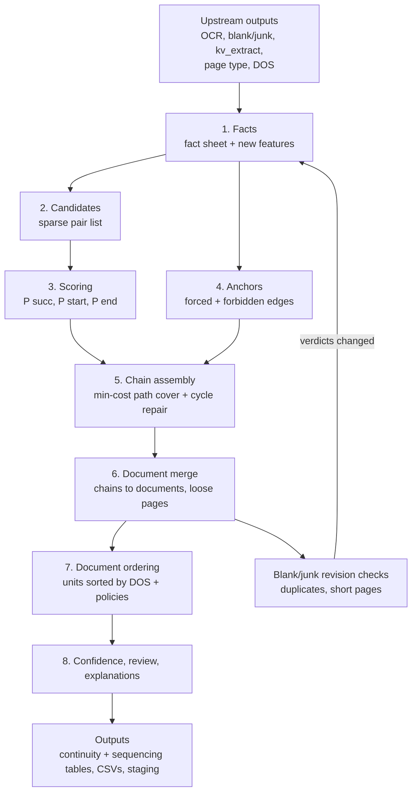

# Page Assembly v3: Design and Build Plan

Joint page sequencing and document continuity for the imaging pipeline

| | |
|---|---|
| Status | Draft for team review |
| Date | 19 November 2026 |
| Replaces | Decision logic of `continuity` (stage 87) and `page_sequencing` (stage 95) |
| Keeps | Fact sheet inputs, J series, canon mechanism, review UI, `seqsort` module and parity tooling |
| Code home | `sequencing_sorting/seqsort/assembly/` first, then `core-pipeline/stages/lib/assembly/` |
| Constraints | No LLM. CPU only. Python 3.12. PHI stays inside the current boundary. Stage table unchanged. |

---

## 0. How to use this document

This document has two audiences.

- **The team** reads sections 1 to 13 to agree on the design. Section 17 lists the decisions still open.
- **Coding agents (Cursor, Claude Code)** work from section 14 (build plan) task by task. Each task names its files, its inputs and outputs, and its acceptance criteria. Section 18 gives the rules every agent task must follow. Sections 7 to 11 are the specification the tasks point back to.

Section numbers in brackets such as [SEQ 5.4] refer to the existing document *Page Sequencing and Document Continuity*. Brackets such as [REF 11.3] refer to the *Imaging Pipeline Technical Reference*.

---

## 1. Summary

Today, continuity scores only the gap between two pages that are next to each other in scan order, and sequencing moves only pages that print a confident "page n of m", by at most 5 places, using only the chart's single most common page-number family. Nothing orders documents relative to each other. As a result:

- an out-of-order document is split or glued to the wrong neighbour before sequencing ever sees it,
- unnumbered pages never move,
- every document numbered with a different total stays in scan order,
- documents such as multiple prescriptions are not sorted by date of service.

Page Assembly v2 solves the three questions jointly, each with the evidence that fits it:

1. **Successor.** Which page comes directly after which? Answered by scoring candidate page pairs anywhere in the chart and solving a global minimum-cost path cover (an exact assignment problem).
2. **Same document.** Which chains of pages form one document? Answered by a merge step over chains, using identity, date and template evidence.
3. **Document order.** In what order do documents appear? Answered by sorting encounters by date of service under configurable, ground-truth-verified policies.

Near-certain rules (page-number arithmetic, conflicting trust-5 dates, Demographics boundaries) become hard constraints. Everything else is weighted by small, calibrated models (LightGBM and a MiniLM cross-encoder) trained on the client sequence ground truth already in `page_ground_truth`. The system ships first with weights converted from today's canon (cold start), so the solver's gain and the learning gain are measured separately. A do-no-harm margin keeps well-scanned charts in scan order.

---

## 2. Background and problem

### 2.1 Current behaviour

| Area | Today | Reference |
|---|---|---|
| Unit of decision | One adjacent gap in scan order | [SEQ 4.4] |
| Scoring | Hand-set points summed; most marked "assumed" | [SEQ 4.4], [REF 12.2] |
| Order | `fenced_order`: only confident "n of m" families move, at most 5 places | [SEQ 5.5] |
| Page-number families | Only the dominant total is kept | [SEQ 5.4] |
| Stage order | Continuity (87) on scan order, then sequencing (95) fenced by continuity documents | [SEQ 2] |
| Cross-encoder | Off, model file absent, output never reaches the order | [SEQ 5.6], [REF 14.2] |
| Document order | Not computed; documents keep scan position | none |
| Confidence | Uncalibrated sigmoid and multipliers | [REF 16] |

### 2.2 Root causes of lost accuracy

| # | Cause | Effect |
|---|---|---|
| RC1 | Scan order is a hard constraint, not a prior | A page can only end up near where it was scanned unless numbered |
| RC2 | Continuity runs before order is known | Out-of-order documents split (visit heading, signed page rules) or join neighbours |
| RC3 | Single dominant page-number family | Other documents' numbers are discarded |
| RC4 | Unnumbered pages never move | Unnumbered out-of-order pages are never fixed |
| RC5 | Decisions are local and independent | Two pages can both "claim" the same neighbour; no competition |
| RC6 | Weights and curves not fitted | Scores and confidences are not calibrated |
| RC7 | `progress_note_runs_on` absorbs without asking whether the break is weak | Labs, consents and prescriptions after an unsigned note join it |
| RC8 | DOS rule 7 fills dates from scan neighbours | An out-of-order page can inherit another document's date, which then drives continuity |
| RC9 | No inter-document ordering | Prescriptions and other documents are not sorted by DOS |

### 2.3 Worked failure (SAMPLE_A)

The second visit is scanned as page 3, 1, 2 (files 8, 9, 10). Its "of 3" markers are read but dropped because the dominant family is "of 2" (RC3). Continuity, walking scan order, joins visit page 3 to the release form before it, then opens a new document at visit page 1 (RC2). With the pages in reading order, continuity gets every gap right. In v2, the "of 3" family is kept, the edges 1→2 and 2→3 are forced anchors, and page 3 cannot be claimed by the release form.

---

## 3. Goals, non-goals and constraints

### 3.1 Goals

| ID | Goal | Measured by (section 13) |
|---|---|---|
| G1 | Higher reading-order accuracy than both scan order and the current engine | Adjacency accuracy |
| G2 | Better document partition | B-cubed F1, encounters exactly matched |
| G3 | Correct order inside documents, including unnumbered pages | Kendall tau within encounter |
| G4 | Documents ordered oldest to newest DOS under the client's conventions | Pairwise document-order accuracy |
| G5 | Calibrated confidence that routes review efficiently | Accuracy vs review-rate curve, reliability table |
| G6 | Every decision explainable in the review UI | Top contributing evidence per edge |
| G7 | Never worse on well-scanned charts | No regression on the "already in order" slice |

### 3.2 Non-goals

- Changing OCR, blank/junk, kv_extract, page type, DOS extraction or encounter type logic (except the small additions in section 7.1 marked **upstream**).
- Moving or renaming files. The output stays a suggested order.
- Any LLM, hosted model or network call at inference time.
- Changing the `pipeline_stage` table or the stage order contract test.

### 3.3 Constraints

| ID | Constraint |
|---|---|
| C1 | No LLM anywhere (inference or labelling) |
| C2 | CPU inference only; per-chart assembly time under 10 s for 500 pages, under 60 s for 3,000 pages |
| C3 | Python 3.12 (match core-pipeline; pin `seqsort` to 3.12 as well) |
| C4 | Runtime dependencies limited to: numpy, scipy, pandas, scikit-learn, lightgbm, onnxruntime, Pillow, tokenizers. Training only: torch, transformers. Development only: pytest, hypothesis, mypy. |
| C5 | Deterministic output for the same inputs and model versions |
| C6 | Degrade, never fail: any missing input or model falls back to a defined behaviour and is recorded |
| C7 | Output tables and CSV columns unchanged (new values allowed, new columns only in new files) |
| C8 | PHI never leaves the chart workspace, database or training drive |

---

## 4. Definitions

| Term | Meaning |
|---|---|
| Main page | A page the blank/junk stage kept, after continuity's revision checks |
| J series | Blank, junk and complete-duplicate pages, numbered J1, J2... in scan order, never ordered |
| Candidate pair | An ordered pair (a, b) of Main pages that the scorer evaluates as "b directly follows a" |
| Edge | A chosen successor link a → b |
| Anchor | A forced edge (near-certain) |
| Forbidden edge | A pair that may never be linked |
| Chain | A maximal run of pages joined by chosen edges; a document fragment |
| Loose page | A single-page chain with weak start and end evidence |
| Document | One or more chains merged; has an internal page order |
| Encounter | The unit that is ordered by DOS; one or more documents (see policy P1) |
| Ordering unit | Whatever the document-ordering step sorts: an encounter, or a split-out embedded document |
| Trust | DOS trust tier from the fact sheet: 5 service/admit/discharge, 3 collected/received/weak/printed, 2 keyless [SEQ 4.2] |
| Cold start | Running the v2 solver with scores converted from today's canon points instead of trained models |
| Shadow mode | Running v2 beside the current engine and writing its results only to separate files |

---

## 5. Requirements

### 5.1 Functional

| ID | Requirement |
|---|---|
| FR1 | Produce a total reading order of all Main pages, and the J series unchanged |
| FR2 | Produce a partition of Main pages into documents, each with an internal page order |
| FR3 | Group documents into ordering units and order them by DOS under the policies in section 9 |
| FR4 | Use every page-number family, including fax/print banner counters |
| FR5 | Allow any page to move any distance when evidence supports it |
| FR6 | Treat scan order as a learned prior with an explicit do-no-harm margin |
| FR7 | Enforce anchors and forbidden edges as hard constraints |
| FR8 | Output a calibrated confidence per page, per edge and per document-order decision |
| FR9 | Flag pages for review using thresholds chosen from the coverage curve |
| FR10 | Record, per chosen edge, the top contributing evidence |
| FR11 | Write the same pipeline outputs as today (tables, CSVs, staging files) plus new diagnostic files |
| FR12 | Run with any subset of models missing, falling back to cold-start scores |
| FR13 | Keep continuity's blank/junk revision checks (duplicate encounter, short page) |
| FR14 | Ignore Extracted DOS values whose source is `neighbours` (DOS rule 7) as features |

### 5.2 Non-functional

| ID | Requirement |
|---|---|
| NFR1 | Latency per C2; memory under 2 GB for a 3,000-page chart |
| NFR2 | Determinism per C5 (fixed seeds, stable sorts, no set-iteration order dependence) |
| NFR3 | All thresholds, policies and weights in canon or model files, never hard-coded |
| NFR4 | Every model artefact versioned with its training data manifest and metrics |
| NFR5 | Test coverage: unit tests for every module; golden tests on SAMPLE_A, SAMPLE_C and new synthetic charts |
| NFR6 | Parity tooling extended so every change shows which cells moved |

---

## 6. Architecture

### 6.1 Flow



The revision checks (FR13) run after Step 6 as today. If they change any verdict, Steps 1 to 6 run once more on the revised Main set (at most one extra round).

### 6.2 Module layout (`seqsort`)

```
seqsort/
  assembly/
    __init__.py
    types.py            # dataclasses: PageFacts, Candidate, EdgeScore, Chain, Document, Unit, AssemblyResult
    facts.py            # adapter: continuity fact sheet -> PageFacts (+ new fields)
    features/
      __init__.py       # registry: feature id -> function, family, monotone sign, missing value
      pagination.py
      identity.py
      dates.py
      template.py       # header/footer text + visual fingerprint
      seam.py           # text continuity features, cross-encoder call
      position.py       # template position estimate
      typing_.py        # L1 distribution features
      scan.py
      quality.py        # missingness flags
    candidates.py
    anchors.py
    scoring/
      __init__.py       # Scorer protocol, model loading, fallback chain
      cold_start.py     # canon points -> probabilities
      models.py         # LightGBM successor / boundary / samedoc wrappers
      seam_model.py     # ONNX MiniLM cross-encoder wrapper
      calibration.py    # isotonic maps, load/apply
    solver/
      path_cover.py     # assignment reduction + scipy call
      cycles.py         # cycle detection and repair
      local_search.py   # optional polish (phase 4)
    merge.py            # chain merge + loose page insertion
    ordering.py         # units, DOS keys, policies
    confidence.py       # margins, page/edge/unit confidence, review flags
    explain.py          # TreeSHAP top contributions, cold-start contributions
    outputs.py          # map AssemblyResult -> continuity / sequencing rows and CSVs
    stage.py            # orchestration of steps 1-8
  training/
    labels.py           # GT sequence + encounter_review -> labels
    datasets.py         # candidate tables with labels, grouped folds
    train_successor.py
    train_boundary.py
    train_samedoc.py
    train_seam.py       # MiniLM fine-tune + ONNX export
    fit_position.py     # section -> template position table
    calibrate.py
    report.py           # metrics.json, per-slice tables
  evaluation/
    metrics_v2.py       # metrics in section 13
    oracles.py
    slices.py
  canon/
    assembly_canon.json # new: thresholds, policies, K, margins
tools/
  gt_policy_probe.py    # phase 0 measurements
  gt_inventory.py       # which charts have which ground truth
  shadow_compare.py     # v1 vs v2 side by side
```

The existing `seqsort/continuity/` and `seqsort/sequencing/` stay untouched so parity with the pipeline keeps working. v2 imports helpers from them (fact building, layout bands, signature detection, revision checks) rather than copying.

### 6.3 Core types (`assembly/types.py`)

```python
@dataclass(frozen=True)
class PageFacts:
    page_id: str
    scan_pos: int                    # 0-based position among all pages
    main_idx: int                    # 0-based position among Main pages (scan order)
    kind: Literal["main"]            # only Main pages enter assembly
    text: str
    lines: list[Line]                # with top/bottom when available
    has_positions: bool
    l1_probs: dict[str, float]       # L1 distribution; empty if unknown
    l1: str | None
    title: str | None
    dos_from: date | None
    dos_to: date | None
    dos_trust: int | None            # 5, 3, 2 or None
    dos_source: str | None           # excludes "neighbours" (FR14) -> treated as None
    signed: bool
    signed_in_tail: bool
    markers: list[Marker]            # every page-number reading, all families
    banner: Banner | None            # fax/print banner: counter, total, timestamp, sender
    ids: dict[str, set[str]]         # id_type -> values (visit, fin, csn, account, accession, order, rx)
    sections: list[SectionHit]       # canonical heading + vertical position
    header_lines: list[str]          # masked
    footer_lines: list[str]          # masked
    header_hash: int | None          # 64-bit dHash of header band image
    handwritten: bool
    visual: bool
    kv_ready: bool
    char_count: int

@dataclass(frozen=True)
class Marker:
    n: int
    m: int | None                    # total, None for "Page n"
    pattern: str                     # page_x_of_y, x_of_y, footer_plain_x, extracted, ...
    says_page: bool
    confidence: float
    source: Literal["extracted", "pattern", "banner"]

@dataclass(frozen=True)
class EdgeScore:
    a: int                           # main_idx
    b: int
    p_succ: float                    # calibrated
    cost: float                      # -log(p_succ), clipped
    forced: bool
    contributions: list[tuple[str, float]]   # top-k feature contributions

@dataclass
class Chain:
    pages: list[int]                 # main_idx in chain order

@dataclass
class Document:
    doc_id: int
    pages: list[int]                 # internal order
    chains: list[Chain]
    dos_key: date | None
    dos_trust: int | None
    l1: str | None
    flags: set[str]

@dataclass
class Unit:                          # ordering unit
    unit_id: int
    documents: list[int]
    dos_key: date | None
    tie_rank: int
    anchor_scan_pos: int
    placement: Literal["dated", "undated_anchor", "non_visit"]

@dataclass
class AssemblyResult:
    order: list[int]                 # main_idx in final reading order
    documents: list[Document]
    units: list[Unit]
    edges: list[EdgeScore]           # chosen edges
    page_conf: dict[int, float]
    review: dict[int, list[str]]     # page -> reasons
    diagnostics: dict
```

---

## 7. Detailed design

### 7.1 Step 1: Facts

Build `PageFacts` from the existing continuity fact sheet [SEQ 4.2] and extend it.

| Field | Source | New? |
|---|---|---|
| everything in [SEQ 4.2] | existing `continuity/engine` fact building | no |
| `markers` (all families) | `sequencing/engine/marker_detector` with the dominant-family filter **removed**; plus the extracted marker | changed |
| `banner` | new parser over header/footer bands (section 7.1.1) | **new** |
| `ids` | `kv_extract` member_id rows; **upstream:** add `accession`, `order`, `rx` id types to `id_types.json` | **new types** |
| `header_hash` | 64-bit dHash of the top 12% of the corrected page image (section 7.1.2) | **new** |
| `l1_probs` | `page_classification` axes JSON (model distribution); fall back to one-hot on L1 at the page confidence | changed |
| `dos_*` | Extracted DOS, but values with source `neighbours` are set to None | changed (FR14) |
| `sections` | OCR JSON matched headers + staged headings, with vertical position | no |

#### 7.1.1 Fax and print banners

Fax machines and EHR print jobs stamp a line at the top or bottom of every page. Typical forms:

```
11/03/2025 14:22  FROM: 555-123-4567  TO: 555-987-6543   P.004/012
Nov 3 2025 2:22PM  HP Fax  ...  Page 4 of 12
Printed by: jdoe  10/30/2025 08:10  Page 4
```

Parser rules:

- Search only the header band (top 10%) and footer band (bottom 8%) lines.
- Counter patterns: `P\.?\s*0*(\d{1,4})\s*/\s*0*(\d{1,4})`, `Page\s+(\d+)\s+of\s+(\d+)` when the same line also holds a timestamp, `(\d{1,4})\s*/\s*(\d{1,4})` next to a fax number.
- Timestamp: date + time on the same line (the print stamps DOS already strips).
- Banner identity: the line with digits masked except the counter and timestamp, hashed. Pages with the same banner identity and timestamp belong to one transmission.
- Output `Banner(counter, total, timestamp, identity_hash, band)`.

A banner counter is a marker with `source="banner"`. One transmission's counter gives the original transmission order, which is usually but not always reading order (a fax can carry several documents). So banner sequences are **strong features**, and become **anchors** only when the counter runs n→n+1 within one transmission **and** there is no trust-5 date conflict **and** the pages do not carry conflicting document page numbers.

#### 7.1.2 Header fingerprint

- Load the corrected image (fall back to the original), convert to greyscale, crop the top 12%.
- Resize to 9 x 8, compute the 64-bit difference hash (dHash) with numpy (no extra dependency).
- Similarity between pages = 1 - Hamming distance / 64.
- Skip (None) for visual pages, blank-looking crops (ink below 0.5%) and handwritten pages.

Cost: one image read per Main page; about 5 ms each.

### 7.2 Step 2: Candidates

For every Main page a, the candidate successors b (b ≠ a) are the union of:

| Source | Rule |
|---|---|
| Scan window | `|main_idx(b) - main_idx(a)| <= K` (K from canon, default 10; set by Phase 0) |
| Page-number family | b has a marker with the same total m as one of a's markers (any distance) |
| Banner | same transmission identity |
| Identity | shares any `ids` value of type visit, fin, csn, account, accession, order, rx |
| Date | same trust-5 DOS (any distance), capped at the 30 nearest by scan distance |
| Template | header hash similarity >= 0.90, capped at the 20 nearest |

Cap the candidate list per page at `max_candidates_per_page` (default 80), keeping the closest by scan distance after the family, banner and identity sources (which are never dropped). Record each candidate's sources as a bitmask feature.

Phase 0 measures recall: the share of true successors present in the candidate set. Target at least 99.5%.

### 7.3 Step 3: Features and scoring

#### 7.3.1 Pair features (successor model)

Full catalogue in Appendix A. Families:

- **Pagination:** same family and `n_b = n_a + 1`; same family and `n_b <= n_a` (wrong direction); a prints "n of n" (last page); b prints "1 of m" (first page); "Page n" without total arithmetic; banner counter arithmetic; marker confidences.
- **Identity:** count of shared ids by type; any conflicting visit/fin id (both present, none shared).
- **Dates:** both dated; same date; different date; date gap in days (signed, clipped); min trust; b inside a's admit-discharge range; a or b undated.
- **Template:** identical masked header line; identical masked footer line; header token Jaccard; header hash similarity; same banner transmission; banner timestamp equal.
- **Seam:** cross-encoder probability; char 3-5-gram TF-IDF cosine of a's last 6 lines vs b's first 6 lines (body only, furniture removed); a cut mid-sentence; b starts lowercase; a says "continued"; numbered list continues (last item k on a, first item k+1 on b); table continues (same masked column header tokens).
- **Position:** a signed in tail; a signed anywhere; a page fill; b has title; b has visit heading in top third; template position estimate of a and b and their difference; a has end markers; b has start markers.
- **Type:** P(same L1) = sum over families of `p_a(f) * p_b(f)`; same full type path; a or b Demographics / Clinical Summary.
- **Scan:** signed scan distance `main_idx(b) - main_idx(a)`; absolute log distance; b is a's scan successor; number of Main pages between; blank pages between in scan order.
- **Quality:** a or b handwritten, visual, no positions, kv not ready, thin text; candidate source bitmask.

Missing values stay NaN (LightGBM handles them natively) and each family has an explicit "available" flag.

#### 7.3.2 Page features (boundary model)

For each page: title, visit heading, "1 of m", "n of n", signed in tail, signed anywhere, page fill, says continued, template position, section start/end markers, L1 probabilities (top 3), dated and trust, scan neighbours' L1 agreement, char count, quality flags. Two heads, trained separately: P(start) and P(end).

#### 7.3.3 Scorer protocol and fallback chain

```python
class Scorer(Protocol):
    version: str
    def successor(self, facts, candidates) -> np.ndarray      # p_succ per candidate
    def boundary(self, facts) -> tuple[np.ndarray, np.ndarray] # p_start, p_end per page
    def same_doc(self, frag_features) -> np.ndarray
    def contributions(self, kind, rows, top_k=5) -> list[list[tuple[str, float]]]
```

Load order per model, recorded in diagnostics:

1. Trained LightGBM model + calibration map from `models/assembly/<version>/`.
2. Cold-start scorer (section 7.3.4).

The seam cross-encoder is a feature, not a scorer. Missing ONNX file means the feature is NaN and `seam_model_available = 0`.

#### 7.3.4 Cold-start scorer

Converts today's canon to probabilities so the solver runs before any training:

- **Successor:** compute today's gap score `s(a, b)` from `continuity_canon.json` signals, evaluated on the pair as if b followed a (pair, ending and opening signals; DOS compared against a's document date approximated by a's own date). Then `p_succ = sigmoid(-s / 2) * prior(scan distance)`, where `prior(d) = 1` for d = 1, `0.5` for 2 <= d <= 3, `0.25` beyond, and 0.05 for d < 0 (b scanned before a) unless a page-number family supports it.
- **Boundary:** `p_end(a) = sigmoid(ending_score(a) / 2)`, `p_start(b) = sigmoid(opening_score(b) / 2)`.
- **Same document:** rules from today's final pass expressed as scores (same date, same visit id, continued, same type untitled).
- Contributions = the individual signal points.

The cold-start scorer must reproduce, on scan-ordered charts with no out-of-order pages, the same partition as today's engine on at least 95% of gaps (test in task P2-T6). It is a starting point, not a parity target.

### 7.4 Step 4: Anchors and forbidden edges

#### 7.4.1 Forced edges

| Anchor | Condition |
|---|---|
| A1 page numbers | a and b both have a marker in one family (same m, `says_page` or extracted, confidence >= 0.92), `n_b = n_a + 1`, no trust-5 date conflict, and no other page claims (n_a + 1, m) within the same date group |
| A2 banner | same transmission, counter n → n+1, conditions as A1, and neither page has a document page number contradicting it |
| A3 section continued | b's top reads "<Section> (continued)", a contains that section, a not signed in tail |

Conflicts: if two pages claim the same (n, m) in one date group, or a page would get two forced successors, none of the conflicting anchors is forced. They stay as high-probability candidates and the pages get review reason `anchor_conflict`.

Forced edge implementation: for anchor a → b, remove every other edge leaving out(a), every other edge entering in(b), the edge out(a) → END(a) and the edge START(b) → in(b).

#### 7.4.2 Forbidden edges

| Rule | Condition |
|---|---|
| F1 dates | both trust 5, different dates, and neither lies inside the other's admit-discharge range |
| F2 demographics | exactly one of a, b is Demographics / Patient Information / Patient Registration (today's rule [SEQ 4.7]) |
| F3 identity | both carry a visit/fin/csn id and share none |
| F4 first page | b prints "1 of m" with confidence >= 0.92 (b must start a document) |
| F5 last page | a prints "m of m" with confidence >= 0.92 (a must end a document) |

Forbidden rules are configurable in `assembly_canon.json` and each can be switched off. Every forbidden edge is logged with its rule in diagnostics.

### 7.5 Step 5: Chain assembly

#### 7.5.1 Reduction to assignment

Let n be the number of Main pages. Build a bipartite graph with 2n left nodes and 2n right nodes:

| Left node | Right node | Cost |
|---|---|---|
| out(a) | in(b), for each surviving candidate | `c_succ(a,b) = -log(max(p_succ, eps))` |
| out(a) | END(a) | `c_end(a) = -log(max(p_end(a), eps))` |
| START(b) | in(b) | `c_start(b) = -log(max(p_start(b), eps))` |
| START(a) | END(a) | `eps0` (tiny positive, e.g. 1e-9) |

A full minimum-cost matching chooses, for every page, either one successor or "ends here", and for every page either one predecessor or "starts here". The START(a) → END(a) edges absorb unused dummy nodes. Each page's START/END pair is private to that page, so the graph stays sparse (about n * candidates + 3n edges).

Scale the costs with canon weights: `w_succ * c_succ`, `w_bound * (c_start + c_end)`, defaults 1.0, tuned in Phase 3 on validation charts.

**Do-no-harm margin.** For each candidate with `main_idx(b) != main_idx(a) + 1` (a non-scan link), add `move_margin` (canon, default 0.7 nats, tuned) to its cost. A page leaves its scan neighbour only when the alternative is clearly better.

#### 7.5.2 Solving

```python
from scipy.sparse import csr_matrix
from scipy.sparse.csgraph import min_weight_full_bipartite_matching

def solve(n, edges):                       # edges: list of (left, right, cost) with cost > 0
    rows, cols, w = zip(*edges)
    G = csr_matrix((w, (rows, cols)), shape=(2 * n, 2 * n))
    left_to_right = min_weight_full_bipartite_matching(G)[1]   # (row_ind, col_ind)
    return left_to_right
```

Index plan: left `0..n-1` = out(a), left `n..2n-1` = START(a); right `0..n-1` = in(b), right `n..2n-1` = END(a).

Notes for implementers:

- Every cost must be strictly positive. Explicit zeros in a scipy sparse matrix may be treated as missing edges. Use `eps0` for zero-cost edges.
- A full matching always exists (START(a) → END(a) plus out(a) → END(a) and START(b) → in(b) give a feasible solution), so the call never raises for feasibility once forced-edge removal keeps those dummy edges for every non-anchored page.
- If scipy raises (numerical issue), fall back to a greedy matcher (best edges first, respecting slots) and record `solver=greedy`.

#### 7.5.3 Reading chains and repairing cycles

- Follow successors from every page whose predecessor is START. Each walk is a chain.
- Pages not visited belong to cycles (a ring with no START).
- Repair: for each cycle, remove its highest-cost non-forced edge from the graph and re-solve. Repeat until there are no cycles or `max_cycle_repairs` (default 20) is reached. After that, break any remaining cycle at its highest-cost edge directly (no re-solve) and flag its pages `cycle_broken`.

#### 7.5.4 Local search (optional, Phase 4)

Independent edge costs cannot see whole-document effects (a document with two signed pages, a note whose sections run backwards). A short local search improves the full objective:

- Moves: relocate one page to another slot (or-opt), relocate a run of 2-3 pages, reverse a run of up to 4 pages.
- Objective: sum of chain edge costs plus document penalties (section order violations per document, more than one signed-in-tail page not at the end, mixed trust-5 dates).
- Accept only improving moves; stop after `max_ls_iterations` or no improvement. Deterministic move order.
- Ships only if it improves validation metrics (gate in Phase 4).

### 7.6 Step 6: Document merge and loose pages

#### 7.6.1 Fragment features

For each candidate fragment pair (X before Y in the tentative order, both directions tried):

- shared ids by type, conflicting visit ids,
- DOS: both dated, same, different, gap days, trusts, containment in an admission range,
- header hash max similarity, identical masked header line,
- same banner transmission,
- L1 agreement of the fragments' first pages, P(same L1),
- `p_end` of X's last page and `p_start` of Y's first page,
- successor probability of X.last → Y.first (from Step 3 when it was a candidate, else scored now),
- seam cross-encoder of X.last → Y.first,
- page numbers: X's numbered pages and Y's numbered pages fit one family without collision,
- scan distance between the fragments, fragment lengths, X is a loose page.

Candidate fragment pairs: fragments within `merge_scan_window` (default 15 Main pages) or sharing an id, date or banner.

#### 7.6.2 Merge algorithm

1. Score all candidate fragment pairs with P(same doc).
2. Repeatedly merge the highest-scoring pair with P >= `merge_threshold` (default 0.6, tuned), never across a forbidden edge between their contact pages (F1 to F3) and never when the merge would create a page-number collision.
3. After each merge, recompute features for pairs touching the new fragment.
4. Order pages inside a merged document by, in priority: (a) a consistent page-number family across the document, (b) chain order within each fragment, (c) fragments ordered by their mean template position, (d) scan position of the fragment's first page.

#### 7.6.3 Loose page insertion

A loose page L (single-page chain with `p_start(L) < 0.5` and `p_end(L) < 0.5`) is tried in every slot of every document within `merge_scan_window`:

```
insertion_cost(L, between x and y) = c_succ(x, L) + c_succ(L, y) - c_succ(x, y)
```

with first and last slots using `c_start` and `c_end`. Insert at the lowest cost if it is below `c_start(L) + c_end(L)` (the cost of standing alone); otherwise L stays a one-page document.

#### 7.6.4 Rules kept from today's final pass

| Today | In v2 |
|---|---|
| `split_two_dates` | Enforced by F1 inside documents: a merged document containing two trust-5 dates (no containment) is split at the date change |
| `junk_rejoin` | Not applicable: junk groups are J series and not assembled. Junk group boundaries still written for the continuity output (section 11) |
| `same_date`, `continued_across`, `same_type_untitled`, `orphan_page` | Features of the merge model; cold-start uses them as scores |
| `progress_note_runs_on` | Removed. Cold-start applies the narrowed S1 version: merge only across a weak break into an embedded family (Lab, Medication, Problem List, Questionnaire) or an untitled note, never Consent, Administrative, Demographics, letters, prescriptions |
| `signature_page_joins` | Kept as a constraint: a signature-only page is never a standalone document; it joins by insertion (7.6.3) with standalone cost set to infinity |

#### 7.6.5 Blank/junk revision checks

Run `continuity/duplicates.py` and `continuity/short_pages.py` unchanged on the v2 documents. If any verdict changes, rebuild facts for the changed pages and run Steps 2 to 6 once more. Revisions are written as today [SEQ 4.9].

### 7.7 Step 7: Document ordering

#### 7.7.1 Ordering units

1. Start with the documents from Step 6.
2. **Encounter grouping.** Join documents into one unit when the same-document model, applied at document level, says P >= `encounter_threshold` (default 0.7) **and** they share a trust-5 date or an encounter id. This captures packets the client treats as one encounter (a visit plus its attached consent). Phase 0 checks how `encounter_review` groups documents before this is switched on (policy P1).
3. **Embedded documents.** Under policy P2 = `own_date`, a run of embedded-family pages (Lab Report, Radiology, Order, Medication Record) inside a unit whose trust >= 3 date differs from the unit's date is split out as its own unit. Under P2 = `with_parent` (default until Phase 0 decides), it stays.

#### 7.7.2 Unit date key

- `dos_key` = the earliest trust-5 date in the unit; else the earliest trust-3 date; else None.
- Admission ranges use the admit (From) date.
- The `2222-02-22` non-visit placeholder is never a key; such units get `placement = non_visit`.

#### 7.7.3 Sort

Dated units are sorted by:

```
(dos_key, tie_rank, anchor_scan_pos)
```

- `tie_rank` (policy P3): `type_precedence` uses a ranked list of L1 families from canon (default: Progress Note, Procedure Note, Operative Note, Discharge Summary, Order and Requisition, Lab Report, Medication Record, Immunization, others); `scan` sets `tie_rank = 0` for all.
- `anchor_scan_pos` = scan position of the unit's first page.

Undated units (policy P4):

- `scan_anchor` (default): place the unit directly after the dated unit that precedes it in scan order (or first if none). Several undated units anchored to the same dated unit keep their scan order.
- `end`: place after all dated units, in scan order.

Non-visit units (policy P5): `scan_anchor` (default), `first` or `last`.

#### 7.7.4 Final order

Concatenate units; inside a unit, concatenate its documents by their own (dos_key, scan) order; inside a document, its internal page order. Number Main pages 1..n. Append the J series as today.

### 7.8 Step 8: Confidence, review and explanations

#### 7.8.1 Edge confidence

For a chosen edge a → b:

```
alt_out(a) = min cost over other options of out(a)  (other successors, or END)
alt_in(b)  = min cost over other options of in(b)   (other predecessors, or START)
margin     = min(alt_out(a), alt_in(b)) - cost(a,b)          # in nats, >= 0 for chosen edges
conf_edge  = calib_edge(p_succ(a,b), margin)
```

`calib_edge` is a 2-D isotonic or logistic map fitted on validation charts (Phase 3). Cold start: `conf_edge = p_succ * (1 - exp(-margin))`. Forced edges get `max(0.95, conf_edge)`.

Start and end decisions get the same treatment using the START/END options.

#### 7.8.2 Page, document and unit confidence

- Page: `min(conf(in-decision), conf(out-decision))`.
- Document boundary: the confidence of the start decision of its first page.
- Unit order: product of the DOS confidences of the two neighbouring units' keys (from `dos_extraction_results`), times 0.6 when either is undated or placed by policy.

All confidences pass through `confidence.backed` / `confidence.score` conventions [REF 16] so the review UI bands (>= 0.8 good, 0.5 to 0.8 passable, < 0.5 review) still apply.

#### 7.8.3 Review flags

A page is flagged when any of these hold (each a reason string):

| Reason | Condition |
|---|---|
| `low_edge` | page confidence below `review_threshold` (chosen in Phase 3 from the coverage curve; cold start 0.5) |
| `anchor_conflict` | anchor conflict (7.4.1) |
| `cycle_broken` | cycle broken without re-solve |
| `moved_far_unnumbered` | moved more than `far_move` (default 10) Main positions without a page-number or banner anchor |
| `undated_placed` | in a unit placed by P4 or P5 |
| `long_unnumbered_doc` | in a Main document over 25 pages with no page numbers (today's rule) |
| `degraded` | assembled with cold-start scores because a model was missing |

#### 7.8.4 Explanations

- Trained models: LightGBM `predict(..., pred_contrib=True)` gives TreeSHAP values per feature. Keep the top 5 by absolute value with feature display names from the registry.
- Cold start: the individual canon signal points.
- Stored per chosen edge and per start/end decision; surfaced in `evidence` (continuity table) and the new edges CSV.

---

## 8. Models and training

### 8.1 Labels from ground truth

| Label | Source | Construction |
|---|---|---|
| Reading order | `page_ground_truth.sequence` (client sheet and review UI saves) | Main pages sorted by sequence; J entries dropped; pages the sheet marks blank/junk/invoice moved to J first [SEQ 7] |
| Encounters | `encounter_review` | page -> encounter id |
| Successor positive | consecutive pages in reading order **within one encounter** | (a, b) |
| Successor negative | every other candidate (a, x) from Step 2 | hard negatives by construction |
| Start / end | first / last page of each encounter in reading order | per page |
| Same document | fragment pairs from running Steps 2-5 on the chart with the current scorer: positive when both fragments' pages are in one encounter | per fragment pair |

Charts with sequence but no `encounter_review` contribute order labels only. Use encounters when present; otherwise approximate encounters by the client's DOS + page type sheet columns (flag these charts as `weak_encounters` and test with and without them).

Pages whose verdict differs between pipeline and ground truth (Main vs J mismatch) are dropped from assembly training and counted separately.

### 8.2 Datasets and splits

- One row per candidate pair (successor), per page (boundary), per fragment pair (same document).
- Splits by whole chart: 5-fold grouped cross-validation for development; a fixed held-out test set of 15% of charts (stratified by chart length and share of numbered pages) never used for tuning.
- Synthetic charts (section 15.3) may be added to training folds only, never to test.
- Class balance: do not downsample; use LightGBM `is_unbalance=False` with sample weights so each page's candidate set sums to 1 (each page contributes equally regardless of candidate count).

### 8.3 Model specifications

| Model | Algorithm | Key settings | Output |
|---|---|---|---|
| Successor | LightGBM binary | 255 bins, 31 leaves, lr 0.05, early stopping on grouped validation log-loss, monotone constraints per Appendix A | `successor.txt` |
| Boundary | 2 x LightGBM binary | same | `start.txt`, `end.txt` |
| Same document | LightGBM binary | 15 leaves (less data) | `samedoc.txt` |
| Seam | MiniLM (all-MiniLM-L6-v2) cross-encoder, fine-tuned | input `[CLS] a_last_lines [SEP] b_first_lines`, 256 tokens (128 each side), 3 epochs, lr 2e-5; export ONNX, int8 dynamic quantization | `seam.onnx`, tokenizer |
| Template position | Lookup table, not a model | per canonical section: median relative position within Progress Note encounters, IQR, count | `section_positions.json` |
| Calibration | Isotonic regression on out-of-fold predictions | one map per model; 2-D map for edge confidence | `calibration.json` |

Template position estimate for a page: weighted median of its sections' positions (weights by section count), plus `has_start_markers` (CC, HPI, Reason for Visit in top third), `has_end_markers` (signature block, A/P near bottom).

Seam model inference cost: about 3 to 6 ms per pair on CPU after quantization; called only for candidates within the scan window and for the merge step, about 20 pairs per page. If the per-chart budget would be exceeded, score only the top `seam_max_pairs_per_page` (default 12) candidates by LightGBM pre-score (two-pass: score without seam, pick top-k, add seam, rescore).

### 8.4 Artefacts and versioning

```
models/assembly/<version>/        e.g. asm-2026-12-15
  manifest.json      # charts used (names hashed), counts, feature list + versions, git sha, seeds
  metrics.json       # CV and test metrics, per slice
  successor.txt  start.txt  end.txt  samedoc.txt
  calibration.json
  section_positions.json
  seam/seam.onnx  seam/tokenizer.json
```

`assembly_canon.json` names the active version. A missing file falls back per 7.3.3 and is reported on `/health` and in diagnostics.

### 8.5 Retraining loop

- Every review UI save to the Sequencing tab or `encounter_review` adds labelled charts.
- Retrain monthly or after every 50 newly labelled charts, whichever is first.
- Promote a new version only if it passes the release gates (13.5) on the fixed test set and on the newest 20% of charts.
- Active labelling: export a weekly list of charts with the most `low_edge` flags so reviewers label where the model is least sure.

---

## 9. Configuration: `assembly_canon.json`

```json
{
  "version": 1,
  "model_version": "cold_start",
  "candidates": {
    "K": 10,
    "max_candidates_per_page": 80,
    "date_cap": 30,
    "template_cap": 20,
    "header_hash_min_similarity": 0.90
  },
  "anchors": {
    "marker_min_confidence": 0.92,
    "use_banner_anchors": true,
    "use_section_continued": true
  },
  "forbidden": {
    "F1_dates": true, "F2_demographics": true, "F3_identity": true,
    "F4_first_page": true, "F5_last_page": true
  },
  "solver": {
    "w_succ": 1.0, "w_bound": 1.0,
    "move_margin": 0.7,
    "eps": 1e-6, "eps0": 1e-9,
    "max_cycle_repairs": 20,
    "local_search": false, "max_ls_iterations": 2000
  },
  "merge": {
    "merge_scan_window": 15,
    "merge_threshold": 0.6,
    "narrow_progress_note_absorb": true
  },
  "ordering": {
    "P1_encounter_grouping": "off",
    "encounter_threshold": 0.7,
    "P2_embedded": "with_parent",
    "embedded_families": ["Lab Report", "Order and Requisition", "Medication Record"],
    "P3_tie": "type_precedence",
    "type_precedence": ["Progress Note", "Procedure Note", "Operative Note", "Discharge Summary",
                        "Order and Requisition", "Lab Report", "Medication Record", "Immunization"],
    "P4_undated": "scan_anchor",
    "P5_non_visit": "scan_anchor"
  },
  "review": {
    "review_threshold": 0.5,
    "far_move": 10,
    "long_unnumbered_doc_pages": 25
  },
  "seam": {
    "enabled": true,
    "seam_max_pairs_per_page": 12,
    "lines_each_side": 6
  }
}
```

Read through the existing `canon_store.CanonFile` so edits apply on the next run. Every key has a default in code that matches this file, and a test checks they agree.

---

## 10. Outputs and data contracts

### 10.1 Unchanged outputs (same columns, possibly new values)

| Output | Change |
|---|---|
| `page_continuity_results`, `<chart>_continuity.csv` | `document_seq` and `seq in document` now follow v2 documents in v2 order. `decided_by` adds values `anchor`, `solver`, `merge`, `insertion`, `policy`. `evidence` holds the top contributions. `link_strength` = strong when every edge in the document is an anchor or has conf >= 0.9 |
| `staging/continuity.json` | documents in v2 order; each page's gap before/after described in words from the contributions; new key `assembly` with units and their order |
| `staging/continuity_detail.json` | adds every candidate's features and scores (behind `ASSEMBLY_DEBUG`, since it is large) |
| `page_sequencing_results`, `<chart>_sequencing.csv` | `seq` = v2 order; `sequence_method` = `assembly_anchor`, `assembly_solver`, `assembly_merge`, `assembly_insertion`, `assembly_policy`, or `blank_junk`; `confidence` = page confidence; `review_flag` from 7.8.3 |
| `blank_junk_classification`, `<chart>_junk.csv` | revisions as today |

Contract tests in core-pipeline check that UI columns equal pipeline columns. New enum values must be added to the review UI's label maps (task P5-T4).

### 10.2 New files (seqsort `outputs/<chart>/` and, after integration, `imaging/`)

| File | One row per | Columns |
|---|---|---|
| `<chart>_assembly_edges.csv` | chosen decision (edge, start or end) | a, b, kind, p, cost, margin, confidence, forced, forbidden_alternatives, top contributions |
| `<chart>_assembly_candidates.csv` (debug) | candidate pair | every feature, p_succ, chosen, label (when ground truth exists) |
| `<chart>_assembly_documents.csv` | document | doc_id, pages, first/last page, dos_key, trust, l1, unit_id, flags |
| `<chart>_assembly_units.csv` | ordering unit | unit_id, documents, dos_key, tie_rank, placement, order |
| `<chart>_assembly_eval.csv` | page | algo position, truth position, break, encounter match, per-step attribution |

### 10.3 Diagnostics (in `continuity_detail.json` under `assembly`)

Scorer and model versions used, fallbacks, candidate counts and recall estimate, forbidden edges by rule, anchors and conflicts, cycles repaired, merge steps, timing per step.

---

## 11. Integration into core-pipeline

### 11.1 Stage wiring

- **Stage 87 (`continuity`)**: calls `assembly.stage.run(chart)` behind the flag `ASSEMBLY_ENGINE` (`v1` default, `v2`, or `shadow`). Writes the continuity outputs and stores the order in `staging/continuity.json -> assembly.order`.
- **Stage 90 (`encounter_type`)**: unchanged; reads documents as today.
- **Stage 95 (`page_sequencing`)**: with `ASSEMBLY_ENGINE=v2`, reads `assembly.order` and writes `page_sequencing_results` plus the J series. With `v1`, runs as today.
- **Stage 100**: unchanged (copies `seq`, reads documents).
- `pipeline_stage` table and `STAGE_CHAIN` unchanged.

### 11.2 Modes

| Mode | Behaviour |
|---|---|
| `v1` | Today's engines; v2 not run |
| `shadow` | v1 writes all outputs; v2 runs and writes only `imaging/<chart>_assembly_*.csv` and `staging/assembly_shadow.json` |
| `v2` | v2 writes all outputs |

### 11.3 Code move

- `seqsort/assembly/` copied to `core-pipeline/stages/lib/assembly/` with imports adjusted (as for continuity today [SEQ 10]).
- `assembly_canon.json` into `stages/lib/keyword-canon/`.
- Models under `models/assembly/<version>/`, copied like other weights (not baked into the image); `/health` reports presence.
- Parity: extend `tools/parity_with_pipeline.py` to compare the v2 outputs cell by cell.

### 11.4 Upstream additions (small, separate PRs)

| Change | Where | Why |
|---|---|---|
| `accession`, `order`, `rx` id types | `extraction/member_id/id_types.json` (+ keys) | Identity features for labs and prescriptions |
| Expose DOS `source` per page in the fact sheet | already in `dos_extraction_results` | FR14 |
| None other | | |

---

## 12. Operational behaviour and failure modes

| Situation | Behaviour | Recorded as |
|---|---|---|
| Model file missing or fails to load | That model falls back to cold start (7.3.4) | `degraded` review reason, diagnostics `fallbacks` |
| Seam ONNX missing | Seam features NaN, `seam_model_available = 0` | diagnostics |
| kv_extract not ready | Facts use fallbacks (signature CSV, page-number patterns, regex), quality flag set | `kv_ready = 0` feature |
| No line positions | Bands from line counts as today | `has_positions = 0` feature |
| Header image unreadable | `header_hash = None` | feature missing |
| Solver raises | Greedy matcher | `solver = greedy` |
| Cycle repair limit hit | Direct break | `cycle_broken` |
| Chart with fewer than 2 Main pages | Trivial result, no solver call | none |
| Chart over 3,000 Main pages | Split into blocks at strong boundaries (P(start) > 0.95 and scan gap), solve per block, merge across block edges only via identity/date keys | diagnostics `blocked` |
| Any exception inside v2 in `v2` mode | Stage falls back to v1 for this chart and records it; never fails the chart | `engine_fallback = v1` |

---

## 13. Evaluation framework

### 13.1 Metrics

All metrics are computed on Main pages present in both the algorithm output and the ground truth, after moving ground-truth blank/junk/invoice pages to the J series [SEQ 7].

| ID | Metric | Definition |
|---|---|---|
| M1 | Adjacency accuracy | Take Main pages in algorithm order. A page breaks when it is not the ground truth's next page after the previous one. `1 - breaks / (n - 1)`. Same as the review UI. |
| M2 | B-cubed F1 (partition) | For each page p: precision = `|D(p) ∩ E(p)| / |D(p)|`, recall = `|D(p) ∩ E(p)| / |E(p)|`, where D is p's algorithm document and E its ground-truth encounter. Average over pages, then F1. Order-independent. |
| M3 | Encounters exactly matched | Share of ground-truth encounters whose Main pages form exactly one algorithm document |
| M4 | Legacy gap F1 | Today's continuity metric [SEQ 7] for comparability |
| M5 | Within-encounter Kendall tau | For each ground-truth encounter with 2+ pages, the share of page pairs whose algorithm order agrees with the truth; averaged weighted by pair count |
| M6 | Document-order accuracy | For each pair of ground-truth encounters, compare their order in the truth with the order of their median algorithm positions; share that agree |
| M7 | Perfect-chart rate | Share of charts with M1 = 100% |
| M8 | Review efficiency | Curve of accuracy (M1 on unflagged pages) vs share of pages flagged; report accuracy at 5%, 10%, 20% flagged |
| M9 | Calibration | Expected calibration error of page confidence vs "page has no break before or after it", 10 bins |
| M10 | Latency | p50 / p95 seconds per chart and per 100 pages |

### 13.2 Floors

Every report shows each metric for: scan order (doing nothing), v1 (current engine), v2.

### 13.3 Oracles

| Oracle | Input given | Answers |
|---|---|---|
| O1 | True encounters; algorithm orders pages within and across them | How much is lost in Steps 5 and 7 when partition is perfect |
| O2 | True reading order as the scan order; algorithm partitions | How much partition accuracy depends on order (v1 and v2) |
| O3 | True encounters and true within-encounter order; algorithm orders units only | How good Step 7's policies are |

### 13.4 Slices

Chart length (< 20, 20 to 100, 100 to 500, > 500 pages); share of Main pages with any page number (0, < 50%, >= 50%); scan disorder (Kendall tau of scan vs truth: >= 0.99 "in order", 0.9 to 0.99, < 0.9); handwritten share (> 20%); kv ready vs not; client and project.

### 13.5 Release gates (v2 replaces v1 only if all hold on the held-out test set)

| Gate | Condition |
|---|---|
| RG1 | M1 (ALL) at least 2 points above v1, and M2, M5, M6 not below v1 |
| RG2 | No slice with 20+ charts loses more than 1 point of M1 against v1 |
| RG3 | On the "in order" slice, M1 is at least v1 minus 0.2 points |
| RG4 | M9 (ECE) at most 0.05 |
| RG5 | M10 within C2 |
| RG6 | Two runs give identical outputs (determinism) |
| RG7 | Shadow run on a full production batch: no chart fails, fallback rate below 1% |

---

## 14. Build plan

Each task is sized for one agent session and one pull request. "Done when" is the acceptance test. Estimates assume one engineer with an agent.

### Phase 0: Measurement and policy discovery (about 1 week)

Goal: know the baseline, the data volume, and the client's ordering conventions before building.

| ID | Task | Files | Done when |
|---|---|---|---|
| P0-T1 | Ground-truth inventory | `tools/gt_inventory.py` | Writes `outputs/gt_inventory.csv`: per chart, pages, Main pages, has sequence GT, has `encounter_review`, has DOS GT, run date. Prints totals. |
| P0-T2 | Metrics M1 to M10 | `seqsort/evaluation/metrics_v2.py`, tests | Unit tests on hand-built examples for each metric, including edge cases (1-page chart, all J, missing truth). M1 equals today's review-UI figure on SAMPLE_A (66.7%). |
| P0-T3 | Slices and floors report | `seqsort/evaluation/slices.py`, `report.py` | `python -m seqsort evaluate --all --v2-metrics` writes `evaluation_v2.csv` with scan-order and v1 rows per slice |
| P0-T4 | Oracles O1 to O3 for v1 | `seqsort/evaluation/oracles.py` | Report rows for O1 to O3 on all charts |
| P0-T5 | Policy probe | `tools/gt_policy_probe.py` (Appendix B) | Writes `policy_probe.md` answering Q1 to Q7 with counts and examples (page ids only, no text) |
| P0-T6 | Candidate recall estimate | `tools/gt_policy_probe.py` | Reports distribution of scan distance of true successors and recall of the candidate rules for K in {5, 10, 15, 20} |
| P0-T7 | Baseline document | `docs/assembly_baseline.md` | Team signs off baseline numbers and policy defaults P1 to P5 |

### Phase 1: Quick wins in v1 (about 1 week, optional but recommended)

Goal: bank gains now; v1 becomes a stronger floor. Ported to the pipeline with the normal diff-and-parity process.

| ID | Task | Files | Done when |
|---|---|---|---|
| P1-T1 | Keep every confident page-number family, each fenced by date group | `sequencing/engine/marker_detector.py`, `sequencing/detect.py` | SAMPLE_A visit 2 ordered 6, 7, 8 correctly; no test regressions; M1 ALL not below baseline |
| P1-T2 | Narrow `progress_note_runs_on` (S1) | `continuity/engine.py`, canon | Golden test: unsigned note followed by a prescription keeps them separate |
| P1-T3 | Sequence, then re-run continuity on the suggested order, then sequence again (max 2 rounds) | `continuity/stage.py`, `sequencing/stage.py`, runner | M2/M4 on SAMPLE_A gaps 9/9; report shows round-by-round metrics |
| P1-T4 | Document DOS ordering v0 | new `sequencing/doc_order.py` | Documents sorted by first trust-5 date, undated anchored to scan neighbour; golden test with three prescriptions scanned newest first |
| P1-T5 | Phase 1 report | `docs/assembly_phase1.md` | Numbers vs baseline per slice |

### Phase 2: v2 framework with cold-start scorer (about 3 weeks)

Goal: the full Step 1 to 8 pipeline running end to end in `seqsort`, shadow-comparable, without trained models.

| ID | Task | Files | Done when |
|---|---|---|---|
| P2-T1 | Core types | `assembly/types.py` | Types from 6.3 with docstrings; frozen where stated; `mypy --strict` clean |
| P2-T2 | Facts adapter | `assembly/facts.py` | Builds `PageFacts` for every Main page of SAMPLE_A/C from existing fact building; `neighbours` DOS dropped; all marker families kept; test fixtures |
| P2-T3 | Banner parser | `assembly/features/pagination.py` | Parses the three example forms in 7.1.1 and 10 synthetic variants; never fires on body text; tests |
| P2-T4 | Header fingerprint | `assembly/features/template.py` | dHash on test images: identical letterheads >= 0.95 similarity, different <= 0.7; under 10 ms per page |
| P2-T5 | Feature registry and pair/page features | `assembly/features/*` | Every Appendix A feature implemented with id, family, monotone sign, missing value; unit test per feature |
| P2-T6 | Candidates | `assembly/candidates.py` | Rules of 7.2; source bitmask; cap; test that every family/id/date neighbour is included regardless of distance |
| P2-T7 | Cold-start scorer | `assembly/scoring/cold_start.py` | Implements 7.3.4; on in-order synthetic charts, partition agrees with v1 on >= 95% of gaps |
| P2-T8 | Anchors and forbidden edges | `assembly/anchors.py` | Rules of 7.4; conflicts unforce both; every decision logged; tests for each rule and each conflict type |
| P2-T9 | Path-cover solver | `assembly/solver/path_cover.py` | Reduction of 7.5.1; positive-cost guard; greedy fallback; property tests: each page has at most one successor and one predecessor, forced edges kept, forbidden never chosen; 3,000-page synthetic chart under 10 s |
| P2-T10 | Cycle repair | `assembly/solver/cycles.py` | Test with a constructed cycle; repaired chains valid; limit respected |
| P2-T11 | Merge and insertion | `assembly/merge.py` | Rules of 7.6 with cold-start same-document scores; signature-only page never standalone; page-number collisions never merged; tests |
| P2-T12 | Ordering | `assembly/ordering.py` | Policies P1 to P5 per section 7.7 and canon; golden tests: prescriptions oldest first; undated anchored; same-date ties by precedence |
| P2-T13 | Confidence and review | `assembly/confidence.py` | Margins per 7.8.1; reasons per 7.8.3; tests |
| P2-T14 | Explanations (cold start) | `assembly/explain.py` | Top 5 signal contributions per decision |
| P2-T15 | Outputs | `assembly/outputs.py` | Writes all files in 10.1 and 10.2 with v1 column sets; contract test comparing column lists to v1 CSVs |
| P2-T16 | Stage, revision checks and CLI | `assembly/stage.py`, `runner.py`, CLI | `python -m seqsort run --engine v2 --all` and `--engine shadow`; revision checks run and trigger one rebuild |
| P2-T17 | Canon file and defaults test | `canon/assembly_canon.json` | Section 9 file; test that code defaults equal file values |
| P2-T18 | Phase 2 report | `docs/assembly_phase2.md` | v2 cold start vs v1 vs scan per slice, with oracles; attribution of gains to anchors, solver and ordering via ablation flags |

### Phase 3: Learned models (about 2 weeks)

Goal: replace cold-start scores with trained, calibrated models.

| ID | Task | Files | Done when |
|---|---|---|---|
| P3-T1 | Labels | `training/labels.py` | Section 8.1 labels from `ground_truth.csv` and `encounter_ground_truth.csv`; J reconciliation; `weak_encounters` flag; tests on SAMPLE_A truth |
| P3-T2 | Datasets and folds | `training/datasets.py` | Candidate, page and fragment tables with labels; grouped 5-fold + fixed test split saved as chart lists; per-page sample weights |
| P3-T3 | Successor model | `training/train_successor.py` | Trains with monotone constraints from the registry; early stopping; writes `successor.txt`, CV log-loss and AUC; reproducible with seed |
| P3-T4 | Boundary models | `training/train_boundary.py` | `start.txt`, `end.txt`; metrics |
| P3-T5 | Same-document model | `training/train_samedoc.py` | Fragments generated by running Steps 2 to 5 with the successor model out-of-fold; `samedoc.txt`; metrics |
| P3-T6 | Calibration | `training/calibrate.py`, `assembly/scoring/calibration.py` | Isotonic maps on out-of-fold predictions; reliability tables; M9 computed |
| P3-T7 | Model scorer and fallback chain | `assembly/scoring/models.py`, `__init__.py` | Loads a version folder; per-model fallback; `/health`-style readiness dict |
| P3-T8 | TreeSHAP explanations | `assembly/explain.py` | `pred_contrib` top 5 with display names; test on a fixture model |
| P3-T9 | Tune solver weights, margin, thresholds | `training/tune.py` | Grid or Bayesian search on validation folds over `w_succ`, `w_bound`, `move_margin`, `merge_threshold`, `encounter_threshold`, `review_threshold`; best values written to canon with the search log |
| P3-T10 | Artefact packaging | `training/report.py` | `models/assembly/<version>/` per 8.4 with manifest and metrics |
| P3-T11 | Phase 3 report | `docs/assembly_phase3.md` | Learned vs cold start vs v1 vs scan; release gates RG1 to RG6 evaluated |

### Phase 4: Seam model, template position, local search (about 2 weeks)

| ID | Task | Files | Done when |
|---|---|---|---|
| P4-T1 | Section position table | `training/fit_position.py`, `assembly/features/position.py` | `section_positions.json`; position feature added; ablation shows effect on unnumbered-note slice |
| P4-T2 | Seam model training and export | `training/train_seam.py` | Fine-tuned MiniLM; ONNX int8; held-out AUC reported; inference under 6 ms per pair on CPU |
| P4-T3 | Seam inference with two-pass scoring | `assembly/scoring/seam_model.py` | Feature wired; budget cap honoured; missing model handled |
| P4-T4 | Retrain successor and same-document models with new features | P3 scripts | New version folder; metrics |
| P4-T5 | Local search | `assembly/solver/local_search.py` | 7.5.4; deterministic; ships only if validation M1 or M5 improves without breaking RG3 |
| P4-T6 | Ablation report | `docs/assembly_phase4.md` | Each feature family and step switched off one at a time; contribution table |

### Phase 5: Integration and rollout (about 2 weeks)

| ID | Task | Files | Done when |
|---|---|---|---|
| P5-T1 | Port to core-pipeline | `stages/lib/assembly/`, keyword-canon | Same files with adjusted imports; core-pipeline tests pass |
| P5-T2 | Stage wiring and flag | `stages/lib/continuity/stage.py`, `stages/lib/sequencing/stage.py`, `config.py` | `ASSEMBLY_ENGINE` modes per 11.2; v2 exceptions fall back to v1 per chart |
| P5-T3 | Parity tooling | `tools/parity_with_pipeline.py` | Cell-by-cell comparison of v2 outputs, seqsort vs pipeline, zero differences on samples |
| P5-T4 | Review UI | review-ui frontend/backend | New `decided_by` and `sequence_method` values labelled; Gaps tab shows contributions from `assembly_edges.csv`; Sequencing tab shows unit order and policy placements |
| P5-T5 | Upstream id types | `extraction/member_id/id_types.json` | Accession, order, Rx keys extracted on test pages; kv tests pass |
| P5-T6 | Shadow run | ops | Full production batch in `shadow`; RG7 met; report by client |
| P5-T7 | Promotion | ops, docs | `ASSEMBLY_ENGINE=v2` default after sign-off; v1 kept for one release behind the flag |

### Phase 6: Feedback loop (ongoing)

| ID | Task | Done when |
|---|---|---|
| P6-T1 | Active labelling export | Weekly CSV of charts ranked by `low_edge` count and model disagreement |
| P6-T2 | Retraining script | One command rebuilds labels, datasets, models, calibration and the report; promotion gated by 13.5 |
| P6-T3 | Drift monitor | Monthly: fallback rate, review rate, confidence histogram, M1 on newly labelled charts |

### Dependency order

```
P0 ──> P1 (optional) ──┐
P0 ──> P2 ──> P3 ──> P4 ──> P5 ──> P6
                 └────────────> P5 (can integrate after P3 if P4 slips)
```

---

## 15. Testing strategy

### 15.1 Unit tests

Every module has tests for its rules and edge cases. Features: one test per feature with a positive, a negative and a missing-input case.

### 15.2 Property tests (hypothesis)

On randomly generated synthetic charts:

- The final order is a permutation of the Main pages; the J series is unchanged and in scan order.
- Every forced edge appears in the output; no forbidden edge does.
- Each page has at most one predecessor and one successor among chosen edges.
- Determinism: two runs give byte-identical outputs.
- Do no harm: on a chart generated in order with clean evidence, the output equals scan order.
- Monotonicity: improving a positive piece of evidence for a true edge never removes that edge from the solution (checked on small charts).

### 15.3 Golden synthetic charts (in the `seqsort sample` generator)

| Chart | Scenario | Expected |
|---|---|---|
| SAMPLE_A | existing | M1 = 100%, 6/6 encounters |
| SAMPLE_C | existing revision checks | revisions as today |
| SYN_REVERSED | 6-page numbered note scanned in reverse | restored |
| SYN_INTERLEAVED | two visits' pages alternating, both numbered with different totals | two documents, each in order |
| SYN_RX | five one-page prescriptions, scanned newest first, one undated | oldest to newest; undated anchored per P4 |
| SYN_UNNUMBERED | 4-page unnumbered note shuffled (HPI, Exam, A/P, signature) | restored by template position and seam |
| SYN_FAX | 12-page fax with banner counters, two documents inside | banner order kept, two documents |
| SYN_TWO_PRINTS | same 3-page note printed twice | two documents, each 1-2-3 |
| SYN_LAB_EMBED | visit with a lab collected 3 days earlier filed inside | per P2 policy |
| SYN_DEMOGRAPHICS | demographics page between two visits | standalone, placed per P5 |
| SYN_NO_KV | SAMPLE_A with kv_extract not ready | runs, flags `kv_ready = 0`, still restores numbered documents |
| SYN_LARGE | 3,000 pages generated | latency within C2 |

Synthetic text is generated, never copied from real charts.

### 15.4 Regression on real charts

The fixed test split, run in CI where data is available (not in the public CI), producing the Phase report tables.

---

## 16. Risks and mitigations

| Risk | Likelihood | Impact | Mitigation |
|---|---|---|---|
| Too few labelled charts for stable models | Medium | High | Cold start first; LightGBM on compact features; grouped CV; active labelling; synthetic augmentation in training only |
| Ground-truth sequence noise (client sheets) | Medium | Medium | Label audit in Phase 0 (charts where truth contradicts page numbers); exclude or fix flagged charts |
| v2 moves correct pages (over-reordering) | Medium | High | Move margin, scan features, RG3 gate, `moved_far_unnumbered` review flag |
| Client ordering conventions differ from DOS-ascending assumptions | Medium | High | Phase 0 policy probe; policies configurable per client in canon |
| Upstream noise (DOS errors, kv not ready, weak page type) | High | Medium | Missing-value features, use of L1 distribution, train on noisy charts, ignore neighbour-filled DOS |
| Fax banners misread as page numbers | Low | Medium | Banner anchors require no conflict with document numbers; banner is a separate marker source |
| Performance on very large charts | Low | Medium | Sparse candidates, blocking at strong boundaries, seam budget |
| Divergence between seqsort and pipeline copies | Medium | Medium | Parity tooling and the diff-and-copy process; single source folder copied verbatim |
| Review UI shows unfamiliar labels | Low | Low | P5-T4 maps and tooltips |

---

## 17. Open decisions

| ID | Decision | Default until decided | Decided by |
|---|---|---|---|
| D1 | P2: embedded documents stay with their parent encounter or move to their own date | `with_parent` | Phase 0 Q3 |
| D2 | P3: same-date ties by type precedence or scan order; the precedence list | `type_precedence`, list in section 9 | Phase 0 Q4 |
| D3 | P4: undated documents anchored to scan neighbour or at the end | `scan_anchor` | Phase 0 Q5 |
| D4 | P5: non-visit documents (`2222-02-22`) first, last or scan anchor | `scan_anchor` | Phase 0 Q6 |
| D5 | P1: is the ordering unit the encounter (packets grouped) or the document | `off` (document) | Phase 0 Q2 |
| D6 | Scan window K and move margin | K = 10, margin 0.7 | Phase 0 Q1, Phase 3 tuning |
| D7 | Whether to do Phase 1 quick wins | Yes | Team |
| D8 | Whether banner counters may be anchors or only features | Anchors with conflict checks | Phase 2 results on fax-heavy charts |
| D9 | Per-client policy overrides in canon | Not supported | After Phase 0 if clients differ |

---

## 18. Rules for coding agents (include in every task prompt)

1. Work on exactly one task ID. Read this document's sections that the task names before writing code.
2. Do not modify `seqsort/continuity/` or `seqsort/sequencing/` except in Phase 1 tasks. Import from them instead.
3. Python 3.12, type hints everywhere, `mypy --strict` clean for `seqsort/assembly/`.
4. No new dependencies beyond constraint C4. Ask before adding any.
5. Deterministic code: fixed seeds, `sorted()` over sets and dict keys before iterating where order matters, stable sorts with explicit tie-breakers.
6. No thresholds or weights in code without a canon key and a matching default.
7. Write tests first for solver, anchors, merge and ordering tasks. Every task adds or updates tests; `python -m pytest` must pass.
8. Never put real chart text, names, dates or ids in code, tests, fixtures, logs or commit messages. Use the synthetic generator.
9. Keep functions small and pure where possible: features and scoring take data in and return arrays; only `stage.py` and `outputs.py` touch files.
10. Every fallback path must be recorded in diagnostics; never swallow an exception silently.
11. Update the relevant section of this document if the implementation must differ, and say why in the PR description.
12. Finish each task by running the evaluation (`python -m seqsort evaluate --all --v2-metrics`) when the task can change outputs, and paste the ALL row and the changed slices into the PR.

Task prompt template:

```
You are implementing task <ID> from docs/page_assembly_v2_design_and_build.md.
Read sections: <list>. Follow section 18 rules.
Inputs: <files/types>. Outputs: <files/types>.
Acceptance: <copy the "Done when" cell>.
Start by writing the tests, then the implementation. Show the test run and,
if outputs can change, the evaluation ALL row before and after.
```

---

## Appendix A: Feature catalogue (successor model)

Monotone: `+` means a higher value can only raise P(succ), `-` only lower it, `0` unconstrained.

| ID | Family | Definition | Mono |
|---|---|---|---|
| pg_follows | Pagination | a and b share a family m and n_b = n_a + 1 (best confidence of the pair) | + |
| pg_backwards | Pagination | same family and n_b <= n_a | - |
| pg_gap | Pagination | same family, n_b - n_a (NaN otherwise) | 0 |
| pg_a_last | Pagination | a prints n = m | - |
| pg_b_first | Pagination | b prints 1 of m | - |
| pg_nototal_follows | Pagination | "Page n" without total, n_b = n_a + 1 | + |
| pg_family_conflict | Pagination | both numbered, no shared total | - |
| bn_follows | Pagination | same banner transmission, counter n_b = n_a + 1 | + |
| bn_same_tx | Pagination | same banner transmission | + |
| id_shared | Identity | number of shared id values (visit, fin, csn, account, accession, order, rx) | + |
| id_conflict | Identity | both carry a visit/fin/csn id and share none | - |
| dt_same | Dates | both dated, same date (weighted by min trust) | + |
| dt_diff | Dates | both dated, different date (weighted by min trust) | - |
| dt_gap_days | Dates | signed day difference, clipped to +/- 400 | 0 |
| dt_contained | Dates | one page's date inside the other's admit-discharge range | + |
| dt_any_missing | Dates | either undated | 0 |
| tp_header_same | Template | identical masked header line | + |
| tp_footer_same | Template | identical masked footer line | + |
| tp_header_jacc | Template | header-band token Jaccard | + |
| tp_hash_sim | Template | header image dHash similarity | + |
| sm_ce | Seam | cross-encoder P(b continues a) | + |
| sm_char_cos | Seam | char 3-5-gram TF-IDF cosine, a last lines vs b first lines | + |
| sm_cut_mid | Seam | a's last body line lacks end punctuation | + |
| sm_lower_start | Seam | b's first body line starts lowercase | + |
| sm_continued | Seam | a says continued / cont'd / see next page | + |
| sm_list_next | Seam | numbered list continues from a to b | + |
| sm_table_next | Seam | same masked table header tokens at a's bottom and b's top | + |
| ps_a_signed_tail | Position | a signed in its closing lines | - |
| ps_a_signed_any | Position | a signed anywhere | - |
| ps_a_fill | Position | where a's body text ends (share of height) | 0 |
| ps_b_title | Position | b headed by a canon title | - |
| ps_b_visit_heading | Position | b has a visit heading in its top third | - |
| ps_pos_a | Position | template position estimate of a | 0 |
| ps_pos_b | Position | template position estimate of b | 0 |
| ps_pos_delta | Position | pos_b - pos_a | 0 |
| ps_sections_forward | Position | b's first section later in note order than a's last | + |
| ty_same_l1 | Type | sum_f p_a(f) * p_b(f) | + |
| ty_same_path | Type | same full type path | + |
| ty_demographics | Type | either page Demographics family | 0 |
| sc_dist | Scan | main_idx(b) - main_idx(a) | 0 |
| sc_absdist_log | Scan | log(1 + abs distance) | - |
| sc_is_next | Scan | b is a's scan successor | + |
| sc_blank_between | Scan | blank pages between them in scan order | 0 |
| ql_a_hw / ql_b_hw | Quality | handwritten | 0 |
| ql_a_visual / ql_b_visual | Quality | visual page | 0 |
| ql_positions | Quality | both have line positions | 0 |
| ql_kv_ready | Quality | kv_extract ready for the chart | 0 |
| ql_thin | Quality | either under 150 characters | 0 |
| ql_seam_avail | Quality | seam model available | 0 |
| cd_sources | Candidate | bitmask of candidate sources (one-hot columns) | 0 |

Monotone constraints are applied only where stated; Phase 3 checks each by comparing constrained and unconstrained validation loss and drops a constraint that costs more than 0.5% log-loss.

---

## Appendix B: Phase 0 policy probe (questions and method)

Inputs per chart: `ground_truth.csv` (sequence per page), `encounter_ground_truth.csv`, `<chart>_dos.csv` (Extracted DOS), `<chart>_codeable.csv` (L1), `<chart>_junk.csv`. Output: `policy_probe.md` with tables and page ids, no text.

| Q | Question | Method |
|---|---|---|
| Q1 | How far from scan order are true successors? | For consecutive truth pairs within an encounter: histogram of `main_idx(b) - main_idx(a)`; share with distance 1; recall of candidate rules for K in {5, 10, 15, 20} |
| Q2 | Does the client group documents into encounters (packets)? | Per ground-truth encounter: number of distinct v1 documents and L1 families inside; examples where one encounter holds Consent + Progress Note |
| Q3 | Do embedded labs follow their visit or their own date? | Encounters containing Lab / Radiology pages whose Extracted DOS differs from the encounter's first trust-5 date: are those pages inside the encounter in truth order, or placed by their own date? Count both |
| Q4 | How are same-date documents ordered? | For consecutive truth encounters with the same DOS: pairs of (first L1, second L1); scan order agreement rate; derive precedence if consistent |
| Q5 | Where do undated encounters go? | For each undated truth encounter: is it next to its scan neighbour, at the start, or at the end of the truth order |
| Q6 | Where do non-visit documents go? | Same as Q5 for Demographics, Problem List, Immunization, Patient Information encounters |
| Q7 | Is truth order DOS-ascending at all? | Share of consecutive truth encounters with non-decreasing DOS; list exceptions with their L1s and dates |

Also report: number of charts per question with enough evidence, and charts where truth contradicts printed page numbers (label audit).

---

## Appendix C: Mapping from today's components

| Today | v2 |
|---|---|
| Fact sheet [SEQ 4.2] | `assembly/facts.py` (reused and extended) |
| Gap score signals [SEQ 4.4] | Pair and page features (Appendix A); cold-start scorer uses the canon points |
| Decisive signals, override rules [SEQ 4.6, 4.7] | Anchors and forbidden edges (7.4) |
| Scan-order walk [SEQ 4.8] | Path-cover solver (7.5) |
| Final pass [SEQ 4.8] | Merge model and constraints (7.6) |
| Revision checks [SEQ 4.9] | Unchanged, run after merge |
| Marker detection [SEQ 5.3] | Reused, dominant-family filter removed, banner source added |
| Family choice and `fenced_order` [SEQ 5.4, 5.5] | Removed; page numbers are anchors and features |
| `build_sequence` labels [SEQ 5.6] | Removed; `sequence_method` from the decision that placed the page |
| Cross-encoder (unused) [SEQ 5.6] | Seam model, a feature of the successor and merge models |
| Sequencing confidence [SEQ 5.7] | Margin-based calibrated confidence (7.8) |
| (none) | Document ordering by DOS with policies (7.7) |
